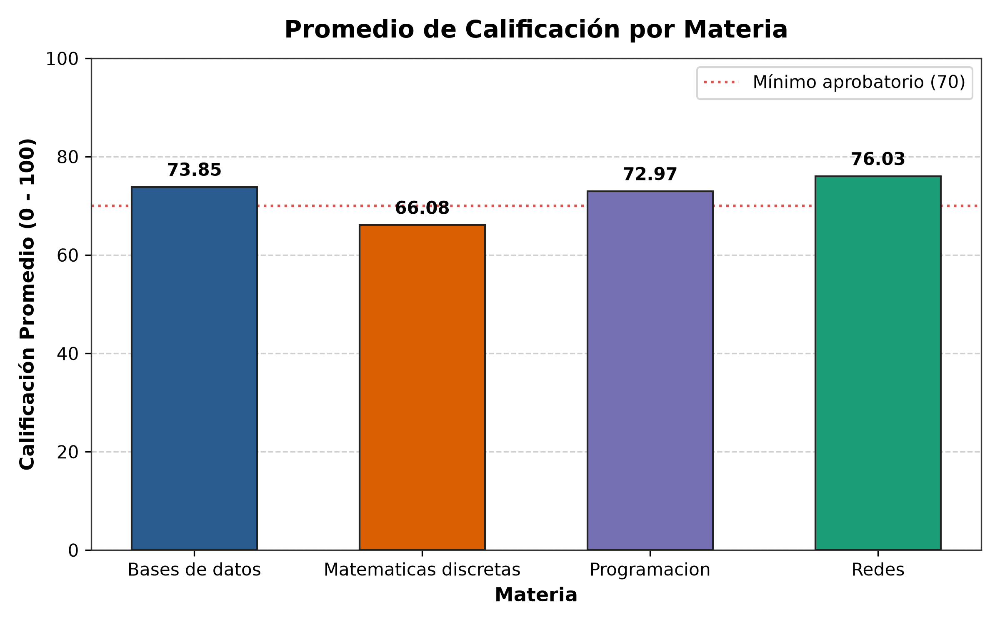
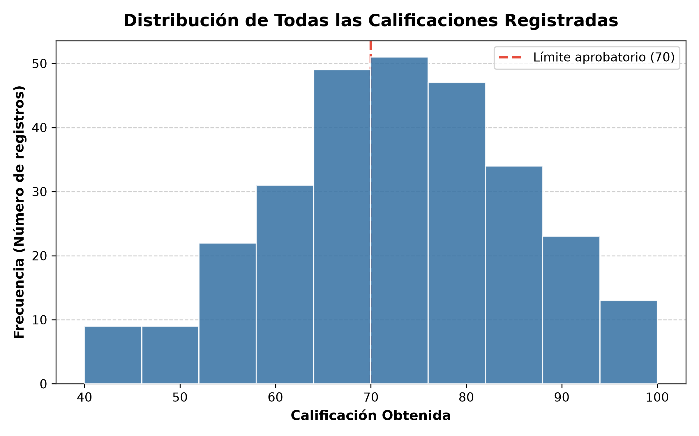
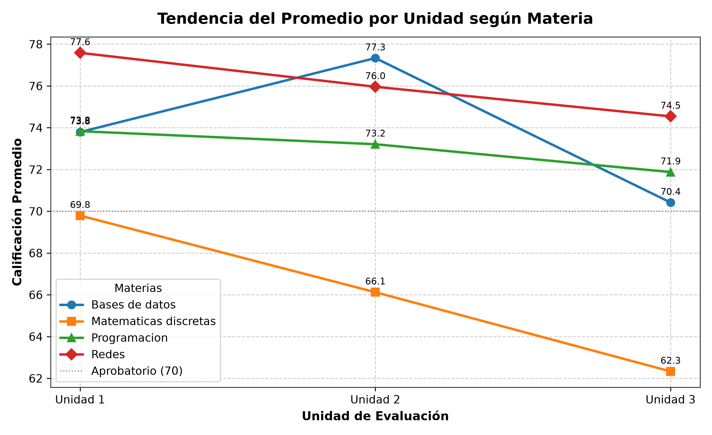

# Práctica de Laboratorio: Análisis y Visualización de Calificaciones con Pandas y Matplotlib

**Tecnológico Nacional de México**  
**Instituto Tecnológico de Ciudad Madero**  
*Departamento de Sistemas y Computación*  
*Ingeniería en Sistemas Computacionales*  

- **Asignatura:** Tópicos Avanzados de Programación
- **Docente:** Dr. Alejandro Estrada Padilla
- **Estudiante:** Eros Manuel Torres Arzola
- **Modalidad:** Individual

---

## 🎯 Objetivo de la Práctica
Cargar un archivo CSV en un DataFrame de **Pandas**, filtrar registros, construir columnas calculadas, resumir información agrupada con `groupby` y comunicar visualmente los resultados obtenidos mediante tres gráficas generadas con **Matplotlib**.

---

## 📊 Descripción del Conjunto de Datos (`calificaciones_isc.csv`)
El dataset contiene **288 registros** correspondientes a una generación de Ingeniería en Sistemas Computacionales distribuida en:
- **24 alumnos** repartidos en dos grupos (**Grupo A** y **Grupo B**).
- **4 materias:** Programación, Bases de datos, Redes y Matemáticas discretas.
- **3 unidades de evaluación** por materia.

$$\text{Total de registros} = 24 \text{ alumnos} \times 4 \text{ materias} \times 3 \text{ unidades} = 288 \text{ filas}$$

### Estructura de Columnas
| Columna | Tipo | Significado |
| :--- | :--- | :--- |
| `matricula` | Texto | Identificador del estudiante (ej. `ISC240100`) |
| `nombre` | Texto | Nombre completo del alumno |
| `grupo` | Texto | Grupo asignado (`A` o `B`) |
| `materia` | Texto | Materia cursada |
| `unidad` | Entero | Unidad evaluada (`1`, `2` o `3`) |
| `calificacion` | Entero | Calificación obtenida (escala de 0 a 100) |
| `asistencias` | Entero | Asistencias registradas en la unidad |

---

## 🚀 Requisitos e Instalación

1. **Clonar el repositorio:**
   ```bash
   git clone https://github.com/erosmanueltorresarzola-wq/practica-pandas-matplotlib.git
   cd practica-pandas-matplotlib
   ```

2. **Instalar dependencias necesarias:**
   ```bash
   pip install -r requirements.txt
   ```
   *(Incluye `pandas`, `matplotlib` y `numpy`)*

3. **Ejecutar el programa principal:**
   ```bash
   python practica_pandas.py
   ```

---

## 📝 Resumen de Ejercicios Realizados

### Ejercicio 1. Carga y Revisión
- Lectura de `calificaciones_isc.csv` en un DataFrame `df`.
- Visualización de primeras 5 filas (`df.head()`).
- Dimensiones del conjunto de datos: **288 filas y 7 columnas**.
- Tipos de datos de las columnas y resumen estadístico (`df.describe()`).
- Documentación del motivo por el cual hay 288 filas en lugar de 24.

### Ejercicio 2. Filtros (sin modificar `df`)
- **Solo Grupo A:** 144 registros.
- **Unidades con calificación reprobatoria (< 70):** 120 registros.
- **Bases de datos, Grupo B, con calificación $\ge$ 80:** 16 registros.
*(Calculados de forma vectorizada con `len(filtro)` sin utilizar ciclos).*

### Ejercicio 3. Columna Calculada (`situacion`)
- Se implementó la columna `situacion` utilizando `np.where`:
  - `"Aprobado"` si `calificacion >= 70`.
  - `"Reprobado"` si `calificacion < 70`.

### Ejercicio 4. Resúmenes Estadísticos y Exportación
1. **Promedio por materia:**
   - Redes: **76.03**
   - Bases de datos: **73.85**
   - Programación: **72.97**
   - Matemáticas discretas: **66.08**
2. **Promedio por grupo y materia:** Comparación detallada entre Grupos A y B.
3. **Promedio general por alumno:** Ordenado descendentemente.
4. **Promedio general por unidad:**
   - Unidad 1: **73.75**
   - Unidad 2: **73.16**
   - Unidad 3: **69.79**
5. **Conteo de unidades aprobadas y reprobadas:**
   - Aprobadas: **168 unidades** (58.33%)
   - Reprobadas: **120 unidades** (41.67%)
6. **Exportación a CSV:** Se generó `promedios_alumnos.csv` con matrícula, nombre y promedio sin conservar el índice de Pandas (`index=False`).

---

## 📈 Visualizaciones Generadas (Matplotlib)

### 1. Promedio de Calificación por Materia
Gráfico de barras con escala vertical de 0 a 100 y línea de referencia del mínimo aprobatorio (70).


### 2. Histograma de Calificaciones
Distribución general de todas las notas registradas con línea divisoria en 70 puntos.


### 3. Tendencia del Promedio por Unidad
Evolución de las calificaciones a lo largo de las tres unidades para cada una de las 4 materias.


---

## 🔍 Ejercicio 6. Lectura de Resultados e Interpretación

1. **¿Qué materia quedó con el promedio más bajo?**  
   **Respuesta:** La materia con el promedio más bajo fue **Matemáticas discretas**, alcanzando únicamente un promedio general de **66.08**, siendo la única materia con promedio por debajo del umbral aprobatorio de 70. Las mejores materias fueron Redes (76.03) y Bases de datos (73.85).

2. **¿El promedio general de la unidad 3 es menor que el de las unidades 1 y 2?**  
   **Respuesta:** **Sí.** El promedio general de la Unidad 3 es de **69.79**, el cual es inferior al obtenido en la Unidad 1 (**73.75**) y en la Unidad 2 (**73.16**). Como se aprecia en la gráfica de tendencias, existe una caída notable del rendimiento hacia el cierre de semestre, especialmente acentuada en materias como Programación y Matemáticas discretas.

3. **¿Cuántos alumnos quedan bajo 70 en su promedio general?**  
   **Respuesta:** Quedan exactamente **7 alumnos** (de un total de 24 estudiantes, es decir, el 29.17% de la generación) con promedio general reprobatorio (< 70):
   1. Ana López — **69.92**
   2. Iván Ramírez — **69.92**
   3. Fernanda Rodríguez — **69.50**
   4. Diana Hernández — **69.08**
   5. Gabriel Sánchez — **67.92**
   6. Víctor Ramos — **66.17**
   7. Kevin Gómez — **64.08**

---

## 📁 Estructura del Proyecto
```text
practica-pandas-matplotlib/
│
├── calificaciones_isc.csv     # Dataset original proporcionado (288 registros)
├── practica_pandas.py         # Código Python con los 6 ejercicios resueltos
├── practica_pandas.ipynb      # Notebook Jupyter interactivo equivalente
├── promedios_alumnos.csv      # CSV exportado con promedios finales por estudiante
├── promedio_materias.png      # Gráfica 1: Barras de promedio por materia
├── histograma.png             # Gráfica 2: Histograma de calificaciones con corte en 70
├── tendencia_unidades.png     # Gráfica 3: Líneas de evolución por unidad
├── requirements.txt           # Dependencias del entorno
├── .gitignore                 # Exclusiones de Git
└── README.md                  # Documentación completa del proyecto
```
